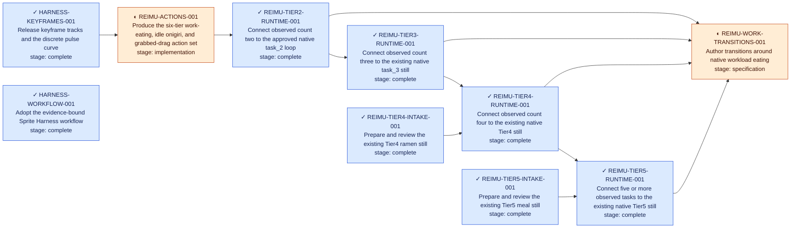

# Sprite Harness progress

This directory is the generated project view. The canonical task source is
[`tasks.json`](tasks.json); lifecycle and evidence rules live in
[`docs/workflow.md`](../docs/workflow.md). Do not hand-edit generated blocks,
[`STATUS.md`](STATUS.md), or [`TREE.mmd`](TREE.mmd).

Use `python workflow/update.py` while editing. Before publication, stage the
intended canonical inputs, run `python workflow/update.py --index`, stage the
generated views, and finish with `python workflow/update.py --index --check`.
That keeps unrelated unstaged work out of the published status view.

Symbols and text are both present: `✓` complete, `◐` active, `!` blocked. Color
is supplementary and never the only status signal.

## Current summary

<!-- BEGIN GENERATED SUMMARY -->
**8 complete** · **1 implementation** · **1 specification**
<!-- END GENERATED SUMMARY -->

## Task register

<!-- BEGIN GENERATED TASKS -->
| Task | Derived stage | Next unsatisfied required gate |
| --- | --- | --- |
| [`HARNESS-KEYFRAMES-001`](STATUS.md#harness-keyframes-001) | **complete** | — |
| [`HARNESS-WORKFLOW-001`](STATUS.md#harness-workflow-001) | **complete** | — |
| [`REIMU-ACTIONS-001`](STATUS.md#reimu-actions-001) | **implementation** | implementation |
| [`REIMU-TIER2-RUNTIME-001`](STATUS.md#reimu-tier2-runtime-001) | **complete** | — |
| [`REIMU-TIER3-RUNTIME-001`](STATUS.md#reimu-tier3-runtime-001) | **complete** | — |
| [`REIMU-TIER4-INTAKE-001`](STATUS.md#reimu-tier4-intake-001) | **complete** | — |
| [`REIMU-TIER4-RUNTIME-001`](STATUS.md#reimu-tier4-runtime-001) | **complete** | — |
| [`REIMU-TIER5-INTAKE-001`](STATUS.md#reimu-tier5-intake-001) | **complete** | — |
| [`REIMU-TIER5-RUNTIME-001`](STATUS.md#reimu-tier5-runtime-001) | **complete** | — |
| [`REIMU-WORK-TRANSITIONS-001`](STATUS.md#reimu-work-transitions-001) | **specification** | specification |
<!-- END GENERATED TASKS -->

## Dependency view

Arrows point from a prerequisite to the task that depends on it. A dependency
edge does not claim that either endpoint passed its technical or visual gates.

<!-- BEGIN GENERATED TREE -->

<!-- END GENERATED TREE -->
