# Sprite Harness progress

This directory is the generated project view. The canonical task source is
[`tasks.json`](tasks.json); lifecycle and evidence rules live in
[`docs/workflow.md`](../docs/workflow.md). Do not hand-edit generated blocks,
[`STATUS.md`](STATUS.md), or [`TREE.mmd`](TREE.mmd).

Use `python workflow/update.py` while editing. Before publication, stage the
intended canonical inputs, run `python workflow/update.py --index`, stage the
generated views, and finish with `python workflow/update.py --index --check`.
That keeps unrelated unstaged work out of the published status view.

Symbols and text are both present: `✓` complete, `◐` active, `!` blocked. Color
is supplementary and never the only status signal.

## Current summary

<!-- BEGIN GENERATED SUMMARY -->
**2 blocked** · **27 complete** · **2 implementation** · **1 visual review**
<!-- END GENERATED SUMMARY -->

## Task register

<!-- BEGIN GENERATED TASKS -->
| Task | Derived stage | Next unsatisfied required gate |
| --- | --- | --- |
| [`HARNESS-KEYFRAMES-001`](STATUS.md#harness-keyframes-001) | **complete** | — |
| [`HARNESS-WORKFLOW-001`](STATUS.md#harness-workflow-001) | **complete** | — |
| [`REIMU-ACTIONS-001`](STATUS.md#reimu-actions-001) | **implementation** | implementation |
| [`REIMU-CUTER-STANDING-INTAKE-001`](STATUS.md#reimu-cuter-standing-intake-001) | **blocked** | blocked |
| [`REIMU-DIALOGUE-ACTIONS-001`](STATUS.md#reimu-dialogue-actions-001) | **complete** | — |
| [`REIMU-EATING-KEYFRAMES-INTAKE-001`](STATUS.md#reimu-eating-keyframes-intake-001) | **complete** | — |
| [`REIMU-EATING-KEYFRAMES-RUNTIME-001`](STATUS.md#reimu-eating-keyframes-runtime-001) | **complete** | — |
| [`REIMU-FAILURE-DROOP-001`](STATUS.md#reimu-failure-droop-001) | **complete** | — |
| [`REIMU-GOHEI-FLOAT-SWEEP-001`](STATUS.md#reimu-gohei-float-sweep-001) | **complete** | — |
| [`REIMU-MANGA-BALLOONS-001`](STATUS.md#reimu-manga-balloons-001) | **complete** | — |
| [`REIMU-NIGHT-SLEEP-001`](STATUS.md#reimu-night-sleep-001) | **complete** | — |
| [`REIMU-POOF-BRIDGE-001`](STATUS.md#reimu-poof-bridge-001) | **complete** | — |
| [`REIMU-PROPS-OFFERING-BOX-INTAKE-001`](STATUS.md#reimu-props-offering-box-intake-001) | **blocked** | blocked |
| [`REIMU-SCENE-REACTIONS-001`](STATUS.md#reimu-scene-reactions-001) | **complete** | — |
| [`REIMU-SHORT-MENU-001`](STATUS.md#reimu-short-menu-001) | **complete** | — |
| [`REIMU-SIT-BRIDGE-001`](STATUS.md#reimu-sit-bridge-001) | **complete** | — |
| [`REIMU-STANDING-YAWN-001`](STATUS.md#reimu-standing-yawn-001) | **complete** | — |
| [`REIMU-TEA-BREAK-001`](STATUS.md#reimu-tea-break-001) | **complete** | — |
| [`REIMU-TIER-EMOTE-LOOPS-INTAKE-001`](STATUS.md#reimu-tier-emote-loops-intake-001) | **complete** | — |
| [`REIMU-TIER-EMOTE-LOOPS-RUNTIME-001`](STATUS.md#reimu-tier-emote-loops-runtime-001) | **complete** | — |
| [`REIMU-TIER-FACE-LOOPS-INTAKE-001`](STATUS.md#reimu-tier-face-loops-intake-001) | **complete** | — |
| [`REIMU-TIER-FACE-LOOPS-RUNTIME-001`](STATUS.md#reimu-tier-face-loops-runtime-001) | **complete** | — |
| [`REIMU-TIER1-INTAKE-001`](STATUS.md#reimu-tier1-intake-001) | **complete** | — |
| [`REIMU-TIER1-RUNTIME-001`](STATUS.md#reimu-tier1-runtime-001) | **complete** | — |
| [`REIMU-TIER2-RUNTIME-001`](STATUS.md#reimu-tier2-runtime-001) | **complete** | — |
| [`REIMU-TIER3-RUNTIME-001`](STATUS.md#reimu-tier3-runtime-001) | **complete** | — |
| [`REIMU-TIER4-INTAKE-001`](STATUS.md#reimu-tier4-intake-001) | **complete** | — |
| [`REIMU-TIER4-RUNTIME-001`](STATUS.md#reimu-tier4-runtime-001) | **complete** | — |
| [`REIMU-TIER5-INTAKE-001`](STATUS.md#reimu-tier5-intake-001) | **complete** | — |
| [`REIMU-TIER5-RUNTIME-001`](STATUS.md#reimu-tier5-runtime-001) | **complete** | — |
| [`REIMU-WAITING-SLOUCH-001`](STATUS.md#reimu-waiting-slouch-001) | **visual review** | visual review |
| [`REIMU-WORK-TRANSITIONS-001`](STATUS.md#reimu-work-transitions-001) | **implementation** | implementation |
<!-- END GENERATED TASKS -->

## Dependency view

Arrows point from a prerequisite to the task that depends on it. A dependency
edge does not claim that either endpoint passed its technical or visual gates.

```mermaid
flowchart LR
    N_HARNESS_KEYFRAMES_001["✓ HARNESS-KEYFRAMES-001<br/>Release keyframe tracks and the discrete pulse curve<br/>stage: complete"]
    N_HARNESS_WORKFLOW_001["✓ HARNESS-WORKFLOW-001<br/>Adopt the evidence-bound Sprite Harness workflow<br/>stage: complete"]
    N_REIMU_ACTIONS_001["◐ REIMU-ACTIONS-001<br/>Produce the six-tier work-eating, idle onigiri, and grabbed-drag action set<br/>stage: implementation"]
    N_REIMU_CUTER_STANDING_INTAKE_001["! REIMU-CUTER-STANDING-INTAKE-001<br/>Prepare a cuter, more chibi standing figure<br/>stage: blocked"]
    N_REIMU_DIALOGUE_ACTIONS_001["✓ REIMU-DIALOGUE-ACTIONS-001<br/>Event remarks, a deeper click ladder and eyelid beats from Reimu's persona<br/>stage: complete"]
    N_REIMU_EATING_KEYFRAMES_INTAKE_001["✓ REIMU-EATING-KEYFRAMES-INTAKE-001<br/>Author hand and mouth eating keyframes for the work tiers<br/>stage: complete"]
    N_REIMU_EATING_KEYFRAMES_RUNTIME_001["✓ REIMU-EATING-KEYFRAMES-RUNTIME-001<br/>Play the eating keyframe loops in the native pet (all five work tiers)<br/>stage: complete"]
    N_REIMU_FAILURE_DROOP_001["✓ REIMU-FAILURE-DROOP-001<br/>Hanging her head and sighing once when the observed work fails<br/>stage: complete"]
    N_REIMU_GOHEI_FLOAT_SWEEP_001["✓ REIMU-GOHEI-FLOAT-SWEEP-001<br/>Gohei on the fourth standing click, floating while dragged, sweeping; and the Codex review of every line<br/>stage: complete"]
    N_REIMU_MANGA_BALLOONS_001["✓ REIMU-MANGA-BALLOONS-001<br/>Draw Reimu's lines as manga speech balloons<br/>stage: complete"]
    N_REIMU_NIGHT_SLEEP_001["✓ REIMU-NIGHT-SLEEP-001<br/>Sleeping at the low table late at night, with rules for falling asleep and waking<br/>stage: complete"]
    N_REIMU_POOF_BRIDGE_001["✓ REIMU-POOF-BRIDGE-001<br/>Smoke display bridge between pose families<br/>stage: complete"]
    N_REIMU_PROPS_OFFERING_BOX_INTAKE_001["! REIMU-PROPS-OFFERING-BOX-INTAKE-001<br/>Prepare the offering box and coin props for standing scenes<br/>stage: blocked"]
    N_REIMU_SCENE_REACTIONS_001["✓ REIMU-SCENE-REACTIONS-001<br/>Scene-aware click reactions, Reimu-voiced lines, and plain standing idle<br/>stage: complete"]
    N_REIMU_SHORT_MENU_001["✓ REIMU-SHORT-MENU-001<br/>Shorter context menu: status line, three actions, three submenus and Quit<br/>stage: complete"]
    N_REIMU_SIT_BRIDGE_001["✓ REIMU-SIT-BRIDGE-001<br/>Drawn sit-down and stand-up poses inside the display bridge<br/>stage: complete"]
    N_REIMU_STANDING_YAWN_001["✓ REIMU-STANDING-YAWN-001<br/>Standing yawn for sleepy clicks and late greetings<br/>stage: complete"]
    N_REIMU_TEA_BREAK_001["✓ REIMU-TEA-BREAK-001<br/>Tea break at the low table after a round of work<br/>stage: complete"]
    N_REIMU_TIER_EMOTE_LOOPS_INTAKE_001["✓ REIMU-TIER-EMOTE-LOOPS-INTAKE-001<br/>Prepare emote-layer life loops for the static Tier1/3/4/5 stills<br/>stage: complete"]
    N_REIMU_TIER_EMOTE_LOOPS_RUNTIME_001["✓ REIMU-TIER-EMOTE-LOOPS-RUNTIME-001<br/>Play the Tier1/3/4/5 emote loops in the native pet<br/>stage: complete"]
    N_REIMU_TIER_FACE_LOOPS_INTAKE_001["✓ REIMU-TIER-FACE-LOOPS-INTAKE-001<br/>Prepare face-motion candidates for the Tier3/4/5 loops<br/>stage: complete"]
    N_REIMU_TIER_FACE_LOOPS_RUNTIME_001["✓ REIMU-TIER-FACE-LOOPS-RUNTIME-001<br/>Play the Tier3/4/5 face loops in the native pet<br/>stage: complete"]
    N_REIMU_TIER1_INTAKE_001["✓ REIMU-TIER1-INTAKE-001<br/>Prepare and review the existing Tier1 onigiri still<br/>stage: complete"]
    N_REIMU_TIER1_RUNTIME_001["✓ REIMU-TIER1-RUNTIME-001<br/>Connect observed count one to the existing native Tier1 still<br/>stage: complete"]
    N_REIMU_TIER2_RUNTIME_001["✓ REIMU-TIER2-RUNTIME-001<br/>Connect observed count two to the approved native task_2 loop<br/>stage: complete"]
    N_REIMU_TIER3_RUNTIME_001["✓ REIMU-TIER3-RUNTIME-001<br/>Connect observed count three to the existing native task_3 still<br/>stage: complete"]
    N_REIMU_TIER4_INTAKE_001["✓ REIMU-TIER4-INTAKE-001<br/>Prepare and review the existing Tier4 ramen still<br/>stage: complete"]
    N_REIMU_TIER4_RUNTIME_001["✓ REIMU-TIER4-RUNTIME-001<br/>Connect observed count four to the existing native Tier4 still<br/>stage: complete"]
    N_REIMU_TIER5_INTAKE_001["✓ REIMU-TIER5-INTAKE-001<br/>Prepare and review the existing Tier5 meal still<br/>stage: complete"]
    N_REIMU_TIER5_RUNTIME_001["✓ REIMU-TIER5-RUNTIME-001<br/>Connect five or more observed tasks to the existing native Tier5 still<br/>stage: complete"]
    N_REIMU_WAITING_SLOUCH_001["◐ REIMU-WAITING-SLOUCH-001<br/>Slouch at the low table while the observed work waits for input<br/>stage: visual review"]
    N_REIMU_WORK_TRANSITIONS_001["◐ REIMU-WORK-TRANSITIONS-001<br/>Author transitions around native workload eating<br/>stage: implementation"]
    N_HARNESS_KEYFRAMES_001 --> N_REIMU_ACTIONS_001
    N_REIMU_SCENE_REACTIONS_001 --> N_REIMU_DIALOGUE_ACTIONS_001
    N_REIMU_TIER_FACE_LOOPS_RUNTIME_001 --> N_REIMU_EATING_KEYFRAMES_INTAKE_001
    N_REIMU_EATING_KEYFRAMES_INTAKE_001 --> N_REIMU_EATING_KEYFRAMES_RUNTIME_001
    N_REIMU_TIER_FACE_LOOPS_RUNTIME_001 --> N_REIMU_EATING_KEYFRAMES_RUNTIME_001
    N_REIMU_STANDING_YAWN_001 --> N_REIMU_FAILURE_DROOP_001
    N_REIMU_FAILURE_DROOP_001 --> N_REIMU_GOHEI_FLOAT_SWEEP_001
    N_REIMU_NIGHT_SLEEP_001 --> N_REIMU_GOHEI_FLOAT_SWEEP_001
    N_REIMU_DIALOGUE_ACTIONS_001 --> N_REIMU_MANGA_BALLOONS_001
    N_REIMU_POOF_BRIDGE_001 --> N_REIMU_NIGHT_SLEEP_001
    N_REIMU_STANDING_YAWN_001 --> N_REIMU_NIGHT_SLEEP_001
    N_REIMU_TEA_BREAK_001 --> N_REIMU_POOF_BRIDGE_001
    N_REIMU_SCENE_REACTIONS_001 --> N_REIMU_PROPS_OFFERING_BOX_INTAKE_001
    N_REIMU_TIER_EMOTE_LOOPS_RUNTIME_001 --> N_REIMU_SCENE_REACTIONS_001
    N_REIMU_SIT_BRIDGE_001 --> N_REIMU_SHORT_MENU_001
    N_REIMU_POOF_BRIDGE_001 --> N_REIMU_SIT_BRIDGE_001
    N_REIMU_GOHEI_FLOAT_SWEEP_001 --> N_REIMU_SIT_BRIDGE_001
    N_REIMU_DIALOGUE_ACTIONS_001 --> N_REIMU_STANDING_YAWN_001
    N_REIMU_DIALOGUE_ACTIONS_001 --> N_REIMU_TEA_BREAK_001
    N_REIMU_EATING_KEYFRAMES_RUNTIME_001 --> N_REIMU_TEA_BREAK_001
    N_REIMU_TIER1_INTAKE_001 --> N_REIMU_TIER_EMOTE_LOOPS_INTAKE_001
    N_REIMU_TIER4_INTAKE_001 --> N_REIMU_TIER_EMOTE_LOOPS_INTAKE_001
    N_REIMU_TIER5_INTAKE_001 --> N_REIMU_TIER_EMOTE_LOOPS_INTAKE_001
    N_REIMU_TIER3_RUNTIME_001 --> N_REIMU_TIER_EMOTE_LOOPS_INTAKE_001
    N_REIMU_TIER_EMOTE_LOOPS_INTAKE_001 --> N_REIMU_TIER_EMOTE_LOOPS_RUNTIME_001
    N_REIMU_TIER1_RUNTIME_001 --> N_REIMU_TIER_EMOTE_LOOPS_RUNTIME_001
    N_REIMU_TIER_EMOTE_LOOPS_INTAKE_001 --> N_REIMU_TIER_FACE_LOOPS_INTAKE_001
    N_REIMU_TIER_FACE_LOOPS_INTAKE_001 --> N_REIMU_TIER_FACE_LOOPS_RUNTIME_001
    N_REIMU_TIER_EMOTE_LOOPS_RUNTIME_001 --> N_REIMU_TIER_FACE_LOOPS_RUNTIME_001
    N_REIMU_TIER5_RUNTIME_001 --> N_REIMU_TIER1_RUNTIME_001
    N_REIMU_TIER1_INTAKE_001 --> N_REIMU_TIER1_RUNTIME_001
    N_REIMU_ACTIONS_001 --> N_REIMU_TIER2_RUNTIME_001
    N_REIMU_TIER2_RUNTIME_001 --> N_REIMU_TIER3_RUNTIME_001
    N_REIMU_TIER3_RUNTIME_001 --> N_REIMU_TIER4_RUNTIME_001
    N_REIMU_TIER4_INTAKE_001 --> N_REIMU_TIER4_RUNTIME_001
    N_REIMU_TIER4_RUNTIME_001 --> N_REIMU_TIER5_RUNTIME_001
    N_REIMU_TIER5_INTAKE_001 --> N_REIMU_TIER5_RUNTIME_001
    N_REIMU_DIALOGUE_ACTIONS_001 --> N_REIMU_WAITING_SLOUCH_001
    N_REIMU_POOF_BRIDGE_001 --> N_REIMU_WAITING_SLOUCH_001
    N_REIMU_TIER2_RUNTIME_001 --> N_REIMU_WORK_TRANSITIONS_001
    N_REIMU_TIER3_RUNTIME_001 --> N_REIMU_WORK_TRANSITIONS_001
    N_REIMU_TIER4_RUNTIME_001 --> N_REIMU_WORK_TRANSITIONS_001
    N_REIMU_TIER5_RUNTIME_001 --> N_REIMU_WORK_TRANSITIONS_001
    N_REIMU_TIER1_RUNTIME_001 --> N_REIMU_WORK_TRANSITIONS_001
    classDef complete fill:#dbeafe,stroke:#1d4ed8,color:#172554;
    classDef active fill:#ffedd5,stroke:#c2410c,color:#431407;
    classDef blocked fill:#fee2e2,stroke:#b91c1c,color:#450a0a;
    class N_HARNESS_KEYFRAMES_001,N_HARNESS_WORKFLOW_001,N_REIMU_DIALOGUE_ACTIONS_001,N_REIMU_EATING_KEYFRAMES_INTAKE_001,N_REIMU_EATING_KEYFRAMES_RUNTIME_001,N_REIMU_FAILURE_DROOP_001,N_REIMU_GOHEI_FLOAT_SWEEP_001,N_REIMU_MANGA_BALLOONS_001,N_REIMU_NIGHT_SLEEP_001,N_REIMU_POOF_BRIDGE_001,N_REIMU_SCENE_REACTIONS_001,N_REIMU_SHORT_MENU_001,N_REIMU_SIT_BRIDGE_001,N_REIMU_STANDING_YAWN_001,N_REIMU_TEA_BREAK_001,N_REIMU_TIER_EMOTE_LOOPS_INTAKE_001,N_REIMU_TIER_EMOTE_LOOPS_RUNTIME_001,N_REIMU_TIER_FACE_LOOPS_INTAKE_001,N_REIMU_TIER_FACE_LOOPS_RUNTIME_001,N_REIMU_TIER1_INTAKE_001,N_REIMU_TIER1_RUNTIME_001,N_REIMU_TIER2_RUNTIME_001,N_REIMU_TIER3_RUNTIME_001,N_REIMU_TIER4_INTAKE_001,N_REIMU_TIER4_RUNTIME_001,N_REIMU_TIER5_INTAKE_001,N_REIMU_TIER5_RUNTIME_001 complete;
    class N_REIMU_ACTIONS_001,N_REIMU_WAITING_SLOUCH_001,N_REIMU_WORK_TRANSITIONS_001 active;
    class N_REIMU_CUTER_STANDING_INTAKE_001,N_REIMU_PROPS_OFFERING_BOX_INTAKE_001 blocked;
```

<!-- BEGIN GENERATED TREE -->

<!-- END GENERATED TREE -->
